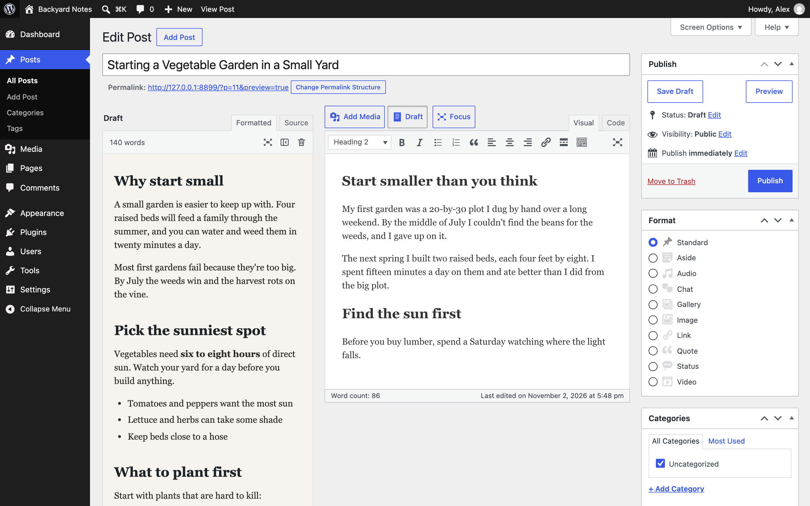
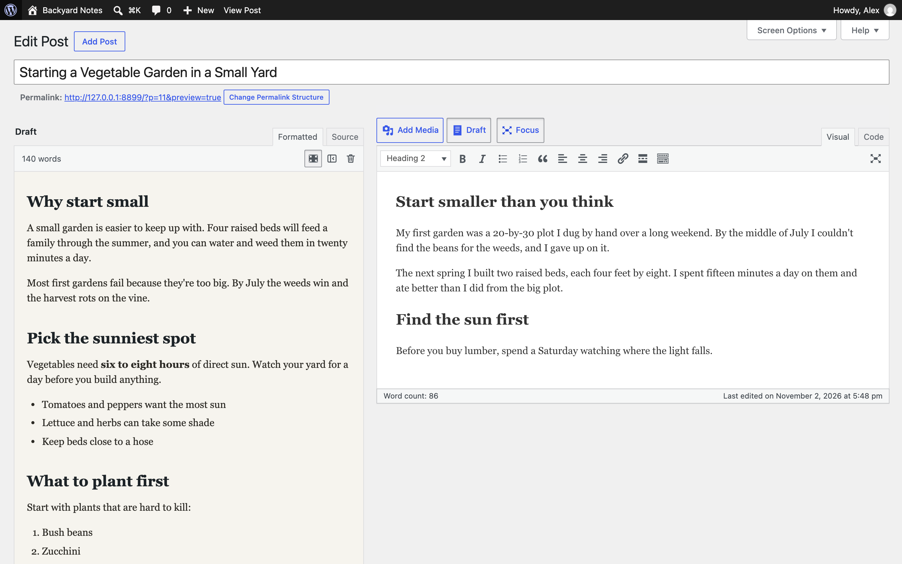
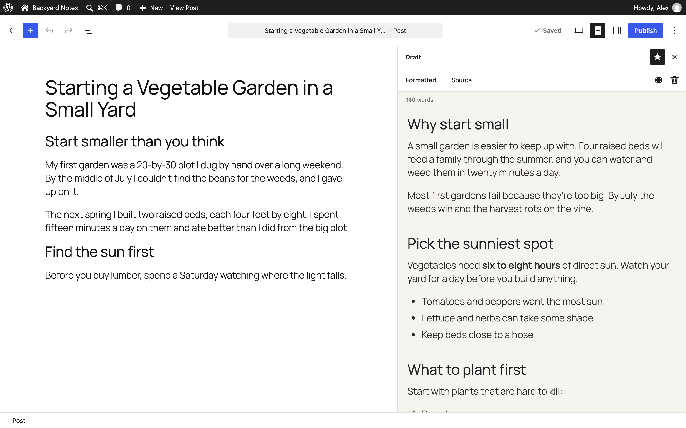

# Sidedraft – Split-Screen Drafts

Keep a draft open beside the editor while you write the post in your own words.

Paste in an outline, an old version, notes, or a draft from anywhere else, then write the real post beside it without switching windows. The draft saves with the post and is never shown on your site, in feeds, or in the public REST API.

Works in the Classic editor, the block editor, and ClassicPress.

## Classic editor

- The draft sits to the left of the editor, at the same height, with its first line level with yours.
- It uses your editor's fonts and sizes, so you can read straight across. It keeps its own background so you always know which side is which.
- Switch between the formatted draft and its source.
- Focus mode hides the admin menu and gives both sides the full width. Press Esc to leave.
- Drag the edge of the draft to resize it.
- Works with ClassicPress and with the Classic Editor plugin.

## Block editor

- The draft opens as a sidebar next to Post and Block settings, so nothing in the editor changes.
- It opens wide for reading and can switch back to the normal sidebar width.
- Pin it to the toolbar with the star in the sidebar header.

## Markdown or HTML

Paste either one. A draft that opens with HTML is shown as HTML. Anything else is read as Markdown, which can include HTML too.

Copy from a web page or the block editor and the draft keeps the headings, paragraphs, lists, tables, and links, as clean HTML without styles or block markup. Text copied from a code or text editor comes through as typed.

Scripts, styles, embeds, forms, and event handlers are removed before the draft is shown.

## Install

1. Download the latest release, or clone this repo into `wp-content/plugins/sidedraft`.
2. Activate it from the Plugins screen.
3. Classic editor: click **Draft** next to Add Media. Block editor: open the ⋮ menu and choose **Draft**.
4. Paste your draft and start writing.

Requires WordPress 6.2 or ClassicPress 2.0, and PHP 7.4.

## License

GPLv2 or later. Markdown is handled by the bundled [marked](https://github.com/markedjs/marked) library (MIT).
